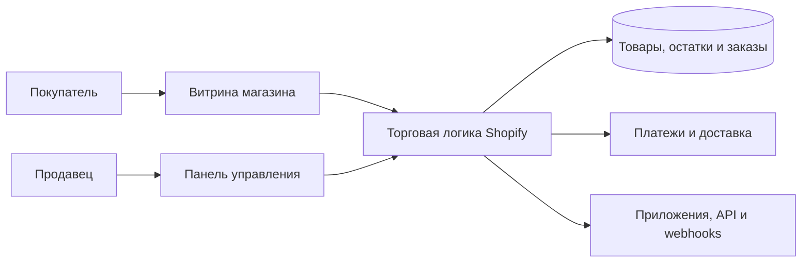
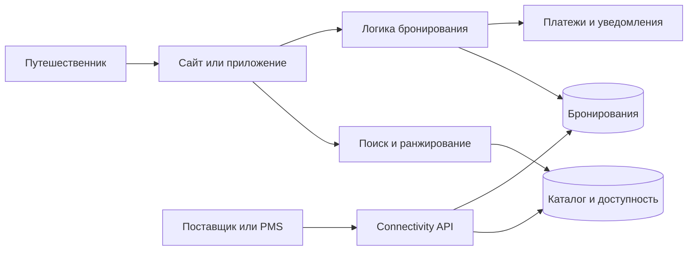

# Сравнительный анализ архитектуры цифровых систем

**Лабораторная работа №5 — пример выполнения**  
**Тема:** сравнительный анализ архитектуры цифровых систем

В работе сравниваются Wikipedia, Shopify и Booking.com. Эти продукты отсутствуют в десяти вариантах лабораторной и относятся к разным классам цифровых систем.

Внутреннее устройство реальных систем известно только частично. Поэтому далее используются два вида утверждений:

- **подтверждённое сведение** — информация из официального описания продукта или технической документации;
- **архитектурная гипотеза** — вероятное или целесообразное решение, предложенное на основании функций и требований системы.

## 1. Выбранные цифровые продукты

| Продукт | Класс | Официальный сайт | Основные источники |
|---|---|---|---|
| Wikipedia | Информационный веб-проект с совместным редактированием | [wikipedia.org](https://www.wikipedia.org/) | [Wikimedia Foundation](https://wikimediafoundation.org/who-we-are/frequently-asked-questions/), [архитектура MediaWiki](https://www.mediawiki.org/wiki/Manual:MediaWiki_architecture) |
| Shopify | SaaS-платформа электронной коммерции | [shopify.com](https://www.shopify.com/) | [Shopify API](https://shopify.dev/docs/api), [Shopify Engineering](https://shopify.engineering/deconstructing-monolith-designing-software-maximizes-developer-productivity) |
| Booking.com | Многосторонняя платформа онлайн-бронирования | [booking.com](https://www.booking.com/) | [How we work](https://www.booking.com/content/how_we_work.html), [Booking.com Developers](https://developers.booking.com/) |

Классы продуктов различаются по назначению и участникам:

- Wikipedia предоставляет свободный доступ к знаниям и позволяет сообществу совместно редактировать материалы;
- Shopify предоставляет продавцам готовую программную среду для управления торговлей;
- Booking.com связывает путешественников с независимыми поставщиками туристических услуг.

## 2. Назначение, пользователи и функции

### Wikipedia

**Назначение:** создание и распространение свободной многоязычной энциклопедии, которую совместно поддерживают добровольцы.

**Основные пользователи:**

- читатели, которые ищут справочную информацию;
- редакторы, создающие и исправляющие статьи;
- участники сообщества и администраторы, следящие за соблюдением правил.

**Ключевые функции:**

1. Поиск и чтение энциклопедических статей.
2. Переход между связанными статьями, категориями и языковыми версиями.
3. Создание и редактирование материалов.
4. Хранение и сравнение истории изменений.
5. Обсуждение содержания статей.
6. Наблюдение за изменениями выбранных страниц.

**Пользовательский сценарий:** читатель вводит запрос → открывает подходящую статью → переходит по ссылке на связанный материал → изучает указанные в статье источники.

### Shopify

**Назначение:** предоставление продавцам облачной платформы для создания магазина и управления товарами, заказами, клиентами и продажами.

**Основные пользователи:**

- продавцы и сотрудники магазинов;
- покупатели интернет-магазинов;
- разработчики приложений и интеграций Shopify.

**Ключевые функции:**

1. Создание и настройка интернет-магазина.
2. Управление товарами, ценами и остатками.
3. Работа с корзиной и оформлением заказа.
4. Управление заказами и покупателями.
5. Подключение платежей, доставки и сторонних приложений.
6. Получение аналитики по продажам.

**Пользовательский сценарий:** продавец входит в панель управления → создаёт товар → указывает цену и остаток → публикует товар в интернет-магазине.

### Booking.com

**Назначение:** предоставление платформы для поиска, сравнения и бронирования туристических услуг независимых поставщиков.

**Основные пользователи:**

- путешественники;
- объекты размещения и другие поставщики услуг;
- connectivity-партнёры, связывающие платформу с системами поставщиков;
- сотрудники поддержки.

**Ключевые функции:**

1. Поиск предложений по направлению, датам и числу гостей.
2. Фильтрация и сравнение результатов.
3. Просмотр цены, доступности, условий и отзывов.
4. Создание и управление бронированием.
5. Обмен уведомлениями и сообщениями.
6. Управление ценами, доступностью и контентом со стороны поставщика.

**Пользовательский сценарий:** путешественник задаёт направление и даты → сравнивает предложения → выбирает подходящий вариант → вводит данные → подтверждает бронирование.

## 3. Компоненты и взаимодействие

Схемы являются логическими. Они показывают назначение компонентов и движение данных, но не описывают точное размещение серверов.

### Wikipedia

| Группа компонентов | Назначение |
|---|---|
| Интерфейс | Сайт, мобильное представление, поиск и редактор статей |
| Прикладная логика | MediaWiki: чтение, разметка страниц, редактирование, права доступа и история версий |
| Данные | Статьи, версии, пользователи, служебные данные и медиафайлы |
| Интеграции | Поисковый сервис, Wikimedia Commons, Wikidata и другие проекты Wikimedia |
| Инфраструктура | Балансировка, кэширующие прокси, серверы приложений, очереди заданий и реплики баз данных |

**Путь запроса:** при чтении статья сначала запрашивается из кэша. Если готовой страницы нет, MediaWiki получает данные статьи, формирует HTML и обновляет кэш. При редактировании запрос обязательно обрабатывается приложением: создаётся новая версия страницы, после чего устаревшая кэшированная копия должна быть удалена.

Многоуровневое кэширование, MediaWiki, реляционные базы и реплики описаны в официальной технической документации. Схема намеренно не показывает все реальные сервисы Wikimedia.

### Shopify

| Группа компонентов | Назначение |
|---|---|
| Интерфейс | Витрина покупателя, панель продавца, мобильные и POS-интерфейсы |
| Прикладная логика | Каталог, остатки, корзина, checkout, заказы, клиенты и аналитика |
| Данные | Товары, варианты, остатки, покупатели, заказы и настройки магазина |
| Интеграции | Платежи, доставка, приложения, Admin API, Storefront API и webhooks |
| Инфраструктура | Облачные вычислительные узлы, балансировка, кэширование, фоновые задания и хранилища |

**Путь запроса:** продавец изменяет товар в панели управления. Прикладная логика проверяет данные и сохраняет изменение. После этого новая информация становится доступна витрине, а подписанные приложения могут получить webhook о событии.

Наличие Admin API, Storefront API, приложений и webhooks подтверждено документацией Shopify. Блок «Торговая логика» объединяет несколько возможных внутренних компонентов и не утверждает, что они развёрнуты как один сервис.

### Booking.com

| Группа компонентов | Назначение |
|---|---|
| Интерфейс | Сайт и приложение путешественника, Extranet поставщика, партнёрские API |
| Прикладная логика | Поиск, ранжирование, цены, доступность, бронирования, платежные сценарии и сообщения |
| Данные | Предложения, тарифы, доступность, бронирования, пользователи и отзывы |
| Интеграции | PMS и channel manager поставщиков, платежные системы и сервисы уведомлений |
| Инфраструктура | Балансировка, кэширование, очереди, вычислительные узлы и реплицируемые хранилища |

**Путь запроса:** пользователь выполняет поиск, используя каталог и сведения о доступности. После выбора предложения логика бронирования повторно проверяет условия, создаёт запись о брони и запускает необходимые уведомления и платёжные действия. Поставщик получает сведения через Extranet или интеграционный API.

Функции платформы и возможности Connectivity API подтверждены официальными материалами Booking.com. Разделение внутренней логики на показанные блоки является архитектурной гипотезой.

## 4. Предполагаемые архитектурные подходы

### Wikipedia: модульное веб-приложение с многоуровневым кэшированием

**Подтверждено:** Wikipedia работает на MediaWiki. Документация описывает серверы приложений, реляционные базы, реплики, очереди заданий и несколько уровней кэширования.

**Предполагаемый подход:** модульное серверное приложение, дополненное специализированными сервисами и распределённой инфраструктурой чтения.

**Аргументы:**

1. Чтений значительно больше, чем изменений, поэтому готовые страницы выгодно отдавать из кэша без запуска полной логики MediaWiki.
2. История версий и совместное редактирование требуют надёжного хранения изменений и контроля прав.
3. Поиск и работа с медиа отличаются от обычного формирования страницы и могут обслуживаться отдельными компонентами.

**Недостаток:** после изменения статьи нужно корректно обновить данные и удалить устаревшие копии из разных уровней кэша.

### Shopify: модульный монолит в ядре и интеграции через API и события

**Подтверждено:** Shopify Engineering описывал развитие основного Rails-приложения от монолита к модульному монолиту. Официальная документация также подтверждает использование API, расширений и webhooks. Публикация о монолите описывает этап развития архитектуры и не доказывает, что вся современная платформа устроена только так.

**Предполагаемый подход:** модульное ядро электронной коммерции, дополненное отдельными инфраструктурными сервисами и событийными интеграциями.

**Аргументы:**

1. Каталог, checkout, заказы и остатки тесно связаны общими бизнес-правилами; модульное ядро упрощает согласованные изменения.
2. Границы модулей снижают связанность кода без обязательного перехода каждой функции в отдельный сервис.
3. API и webhooks позволяют развивать экосистему приложений независимо от основного кода.

**Недостаток:** большое общее приложение требует строгого контроля зависимостей; ошибка или тяжёлое изменение в общей части способно затронуть несколько функциональных областей.

**Событийное взаимодействие:** webhooks сообщают приложениям о создании заказов, изменениях товаров и других событиях без постоянного опроса API.

### Booking.com: сервисно-ориентированная архитектура с событийным взаимодействием

**Подтверждено:** Booking.com предоставляет поиск и бронирование предложений независимых поставщиков, а Connectivity API позволяет партнёрам управлять ценами, доступностью, контентом и бронированиями.

**Архитектурная гипотеза:** для такой платформы целесообразно разделить поиск, каталог, доступность, бронирования, платежи и уведомления на независимо масштабируемые компоненты. Часть обмена между ними может выполняться через события.

**Аргументы:**

1. Поиск создаёт большой поток операций чтения, тогда как бронирование выполняется реже, но требует более строгой проверки состояния.
2. Множество поставщиков постоянно передают изменения цен и доступности через интеграции.
3. Разделение компонентов позволяет независимо масштабировать наиболее нагруженные функции.

**Недостаток:** в распределённой системе сложнее обеспечить согласованность цены, доступности и состояния бронирования, а также расследовать ошибки сквозного запроса.

**Событийное взаимодействие:** обновление поискового индекса, отправка уведомлений и распространение изменений статуса брони могут выполняться асинхронно.

## 5. Сравнительная таблица

| Критерий | Wikipedia | Shopify | Booking.com |
|---|---|---|---|
| Класс системы | Информационный проект с совместным редактированием | SaaS-платформа электронной коммерции | Многосторонняя платформа бронирования |
| Ключевые функции | Чтение, поиск, редактирование, история версий, обсуждения | Управление магазином, товарами, checkout, заказами, приложениями | Поиск, сравнение, доступность, бронирование, кабинет поставщика |
| Основные компоненты | Интерфейс, MediaWiki, кэши, базы статей и версий, поиск | Витрина, панель продавца, торговая логика, данные магазина, API и webhooks | Клиентские интерфейсы, поиск, каталог, бронирования, интеграционные API |
| Возможная архитектура | Модульное приложение со специализированными сервисами и многоуровневым кэшем | Модульное ядро с отдельными сервисами и событийными интеграциями | Сервисно-ориентированная архитектура с синхронными и событийными потоками |
| Масштабируемость | Чтение хорошо масштабируется кэшами и репликами; запись сложнее из-за истории и сброса кэша | Компоненты платформы можно масштабировать по нагрузке, но общее ядро требует контроля ресурсов и границ модулей | Поиск и интеграции можно масштабировать отдельно; бронирование требует контроля конкурирующих изменений |
| Отказоустойчивость | Кэш может продолжать отдавать популярные страницы при части сбоев; редактирование зависит от доступности приложения и записи данных | Нужны резервирование платформы и изоляция тяжёлых магазинов; сбои внешних приложений не должны останавливать основное оформление заказа | Отказ поиска ухудшает подбор предложений, а отказ бронирования непосредственно останавливает продажу; критические компоненты требуют резервирования и повторов |
| Сложность сопровождения | Средняя или высокая: старый крупный код, расширения, много языков и сложная инвалидация кэша | Высокая: большое ядро, много бизнес-функций, API-версии и экосистема приложений | Очень высокая: распределённые операции, множество поставщиков, платежи и необходимость сквозного мониторинга |

Архитектурный подход сам по себе не гарантирует масштабируемость или отказоустойчивость. Эти свойства зависят от конкретной реализации: репликации, тайм-аутов, повторов, идемпотентности, наблюдаемости и процедур восстановления.

## 6. Проверка обоснованности и компромиссы

### Wikipedia

**Главный компромисс:** кэширование ускоряет массовое чтение и снижает нагрузку, но усложняет быстрое распространение изменений. Схема согласуется с функциями: чтение проходит через кэш, а редактирование обращается к MediaWiki и данным версий.

### Shopify

**Главный компромисс:** модульный монолит сохраняет единые бизнес-правила и упрощает согласованные изменения, но модули нельзя полностью независимо развёртывать и масштабировать.

**Условие пересмотра архитектуры:** отдельный модуль целесообразно выделить в самостоятельный сервис, если ему постоянно требуется независимое масштабирование, отдельный цикл выпуска или строгая изоляция отказов. Это не означает необходимость переписывать всю систему на микросервисы.

### Booking.com

**Главный компромисс:** независимые компоненты позволяют масштабировать поиск, интеграции и бронирования по-разному, но усложняют согласованность данных и диагностику сквозных операций. На схеме поэтому чтение доступности отделено от окончательной записи бронирования.

### Проверка согласованности

- Выбраны три разных класса цифровых продуктов.
- Для каждой заявленной функции существует соответствующая группа компонентов.
- Схемы показывают только компоненты, необходимые для описанных сценариев.
- Подтверждённые сведения отделены от предположений о внутренней реализации.
- Оценки масштабируемости и отказоустойчивости связаны с характером нагрузки и критичностью операций.

## 7. Сравнительные выводы

**Вывод 1.** Назначение системы определяет преобладающую нагрузку. Wikipedia оптимизирует массовое чтение готовых страниц, Shopify должен согласованно выполнять торговые правила множества магазинов, а Booking.com сочетает интенсивный поиск с критичными операциями бронирования.

**Вывод 2.** Кэш особенно эффективен для Wikipedia, потому что одна версия статьи многократно читается. Для бронирования нельзя полагаться только на кэш: перед созданием брони необходимо повторно проверить актуальную цену и доступность.

**Вывод 3.** Модульный монолит может быть обоснованным решением для сложной системы. Он позволяет Shopify разделять ответственность в коде, не принимая операционную сложность полностью распределённой архитектуры для каждого модуля.

**Вывод 4.** Чем больше независимых участников и внешних интеграций, тем важнее асинхронное взаимодействие и устойчивость к повторам. Webhooks Shopify и интеграции поставщиков Booking.com не должны требовать постоянного синхронного опроса всех систем.

**Вывод 5.** Более распределённая архитектура даёт возможности независимого масштабирования и изоляции, но повышает требования к мониторингу, согласованности данных и квалификации команды. Поэтому нельзя считать микросервисы универсально лучшим подходом.

### Ограничения исследования

Анализ выполнен по открытым материалам. Для Wikipedia доступна подробная документация MediaWiki, но схема не охватывает всю инфраструктуру Wikimedia. Публикации Shopify описывают известные архитектурные решения на момент публикации, а не гарантированное устройство всей современной платформы. Booking.com раскрывает функции и внешние API, но не публикует полную внутреннюю топологию. Поэтому схемы Shopify и Booking.com содержат явно обозначенные архитектурные гипотезы.

### Источники

1. Wikimedia Foundation. [Frequently asked questions](https://wikimediafoundation.org/who-we-are/frequently-asked-questions/).
2. MediaWiki. [MediaWiki architecture](https://www.mediawiki.org/wiki/Manual:MediaWiki_architecture).
3. MediaWiki. [MediaWiki feature list](https://www.mediawiki.org/wiki/Manual:MediaWiki_feature_list).
4. Shopify. [APIs, libraries, and tools](https://shopify.dev/docs/api).
5. Shopify. [APIs for apps](https://shopify.dev/docs/apps/build/apis).
6. Shopify. [About webhooks](https://shopify.dev/docs/apps/build/webhooks).
7. Shopify Engineering. [Deconstructing the Monolith](https://shopify.engineering/deconstructing-monolith-designing-software-maximizes-developer-productivity).
8. Shopify Engineering. [The State of Shopify's Monolith](https://shopify.engineering/shopify-monolith).
9. Booking.com. [How we work](https://www.booking.com/content/how_we_work.html).
10. Booking.com Developers. [Booking.com APIs](https://developers.booking.com/).
11. Booking.com Developers. [Connectivity APIs](https://developers.booking.com/connectivity/docs).

Источники проверены 2 ноября 2026 года.
