# Лабораторная работа №4 — пример выполнения

**Тема:** Анализ набора данных с помощью SQL  
**Предметная область примера:** сервис аренды велосипедов  
**СУБД:** SQLite  
**Файл базы:** `lab04_example_bike_rentals_expanded.sqlite`

> Образец показывает оформление лабораторной работы на **другой предметной области**. В основной лабораторной студенты используют образовательную базу и самостоятельно выполняют свой вариант. Скриншоты необходимо получить при выполнении SQL в SandboxSQL; изображения по указанным путям пока не включены.

## Шаг 1. Загрузка базы и первичная проверка

В SandboxSQL загружена SQLite-база. Выполнена проверка числа строк во всех шести таблицах.

**Шаг 1 — количество записей.** 

```sql
SELECT 'customers' AS table_name, COUNT(*) AS rows_count FROM customers UNION ALL SELECT 'stations', COUNT(*) FROM stations UNION ALL SELECT 'bicycles', COUNT(*) FROM bicycles UNION ALL SELECT 'rentals', COUNT(*) FROM rentals UNION ALL SELECT 'payments', COUNT(*) FROM payments UNION ALL SELECT 'maintenance', COUNT(*) FROM maintenance;
```

**Результат:**

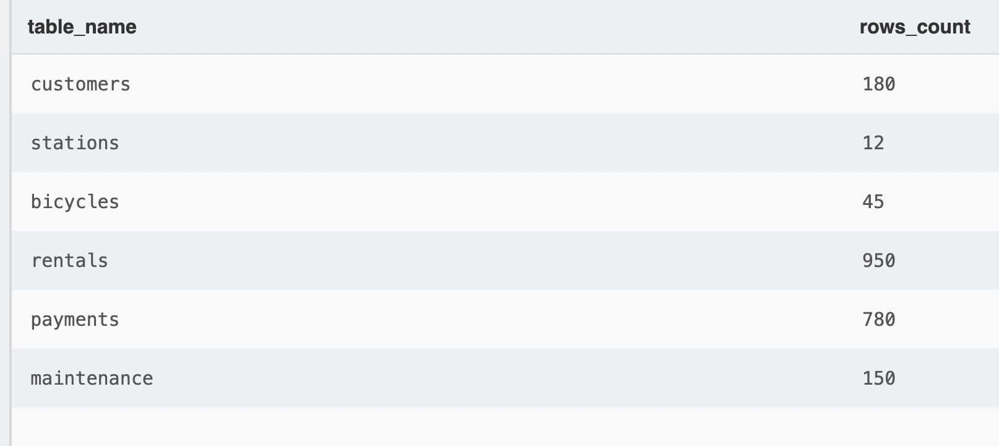

**Вывод:** все шесть таблиц доступны, всего 2117 записей.

## Шаг 2. Изучение структуры и формулирование аналитических вопросов

База содержит шесть связанных таблиц:

| Таблица | Назначение | Основные поля | Записей |
|---|---|---|---:|
| `customers` | Клиенты | `id`, `full_name`, `city`, `registered_at` | 180 |
| `stations` | Пункты проката | `id`, `station_name`, `city`, `capacity` | 12 |
| `bicycles` | Велосипеды и тарифы | `id`, `model`, `category`, `daily_price`, `station_id`, `purchase_year` | 45 |
| `rentals` | Факты аренды | `id`, `customer_id`, `bicycle_id`, `rental_days`, `start_date`, `status` | 950 |
| `payments` | Платежи по завершённым арендам | `id`, `rental_id`, `amount`, `payment_method`, `paid_at` | 780 |
| `maintenance` | Обслуживание велосипедов | `id`, `bicycle_id`, `service_date`, `service_type`, `cost` | 150 |

**Связи:** `bicycles.station_id → stations.id`; `rentals.customer_id → customers.id`; `rentals.bicycle_id → bicycles.id`; `payments.rental_id → rentals.id`; `maintenance.bicycle_id → bicycles.id`. В каждой таблице `id` — первичный ключ. Для `payments.rental_id` задана уникальность: одной аренде соответствует максимум один платёж.

**Шаг 2 — просмотр данных.** Просмотр первых пяти аренд.

```sql
SELECT * FROM rentals LIMIT 5;
```

**Результат:**

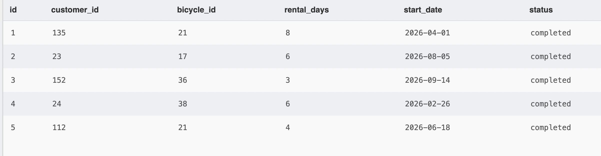

**Шаг 2 — структура таблицы.** Просмотр полей и типов данных таблицы `rentals`.

```sql
PRAGMA table_info(rentals);
```

**Результат:**

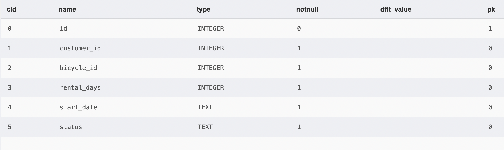

**Сформулированные аналитические вопросы:**

1. Какие велосипеды имеют тариф от 1000 рублей в день? (`bicycles`)
2. Сколько всего аренд зарегистрировано? (`rentals`)
3. Как распределяются аренды по статусам? (`rentals`)
4. Как соотносятся аренды с клиентами и пунктами проката? (`rentals`, `customers`, `bicycles`, `stations`)
5. Есть ли некорректные длительности аренды и платежи без аренды? (`rentals`, `payments`)
6. Какие категории велосипедов принесли наибольшую выручку? (`payments`, `rentals`, `bicycles`)
7. Какие пункты проката связаны с наибольшей выручкой? (`stations`, `bicycles`, `rentals`, `payments`)

## Шаг 3. Фильтрация и сортировка

**Шаг 3 — фильтрация по тарифу.** Отбираем велосипеды с дневным тарифом не ниже 1000 рублей.

```sql
SELECT id, model, category, daily_price FROM bicycles WHERE daily_price >= 1000 ORDER BY daily_price DESC, model LIMIT 10;
```

**Результат:**

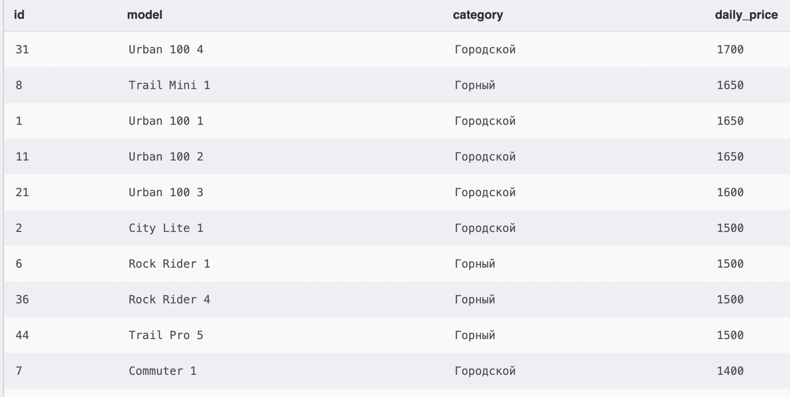

**Шаг 3 — сортировка клиентов.** Выводим клиентов из Казани по алфавиту.

```sql
SELECT id, full_name, city, registered_at FROM customers WHERE city = 'Казань' ORDER BY full_name LIMIT 10;
```

**Результат:**

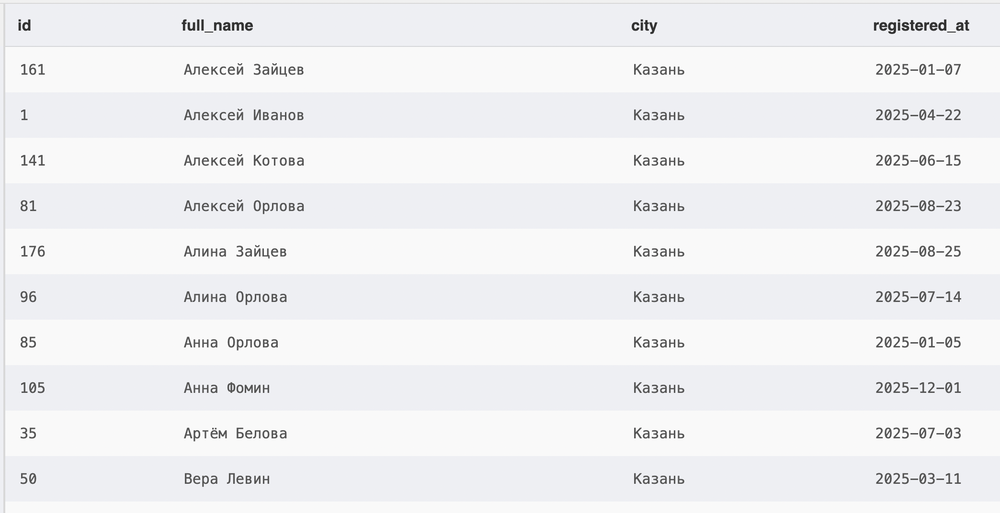

**Вывод:** `WHERE` отбирает нужные строки, `ORDER BY` сортирует, `LIMIT` ограничивает объём вывода.

## Шаг 4. Агрегирование и группировка

**Шаг 4 — подсчёт аренд.** Определяем общее число аренд.

```sql
SELECT COUNT(*) AS total_rentals FROM rentals;
```

**Результат:**

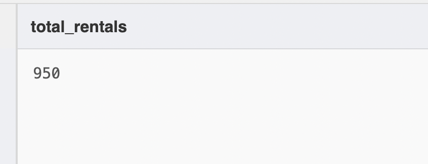

**Шаг 4 — агрегатные функции.** Рассчитываем минимальный, максимальный, средний и суммарный дневной тариф.

```sql
SELECT MIN(daily_price) AS min_price, MAX(daily_price) AS max_price, ROUND(AVG(daily_price),2) AS avg_price, SUM(daily_price) AS sum_prices FROM bicycles;
```

**Результат:**

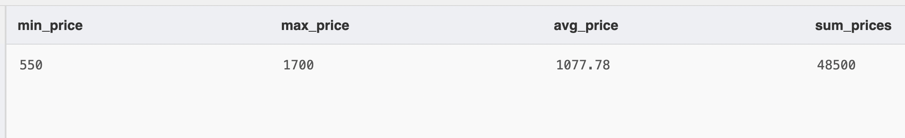

**Шаг 4 — GROUP BY и HAVING.** Группируем аренды по статусу и оставляем статусы, встречающиеся более 100 раз.

```sql
SELECT status, COUNT(*) AS rentals_count FROM rentals GROUP BY status HAVING COUNT(*) > 100 ORDER BY rentals_count DESC;
```

**Результат:**

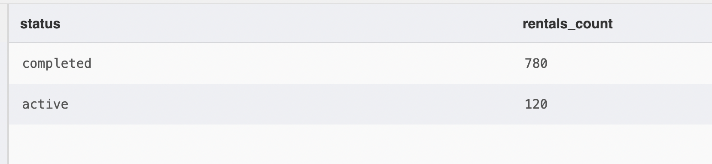

**Вывод:** в базе 950 аренд. `HAVING` отбирает группы после агрегирования; условие применяется к `COUNT(*)`.

## Шаг 5. Объединение связанных таблиц

**Шаг 5 — аренды и клиенты.** Используем `INNER JOIN`, чтобы показать первые 10 аренд вместе с именами клиентов.

```sql
SELECT r.id AS rental_id, c.full_name, r.start_date, r.status FROM rentals r INNER JOIN customers c ON r.customer_id=c.id ORDER BY r.id LIMIT 10;
```

**Результат:**

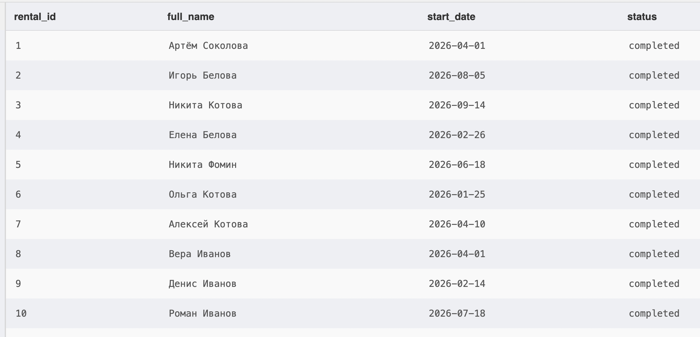

**Шаг 5 — велосипеды и станции.** Используем `INNER JOIN`, чтобы показать первые 10 велосипедов и пункты проката.

```sql
SELECT b.id, b.model, s.station_name, s.city FROM bicycles b INNER JOIN stations s ON b.station_id=s.id ORDER BY b.id LIMIT 10;
```

**Результат:**

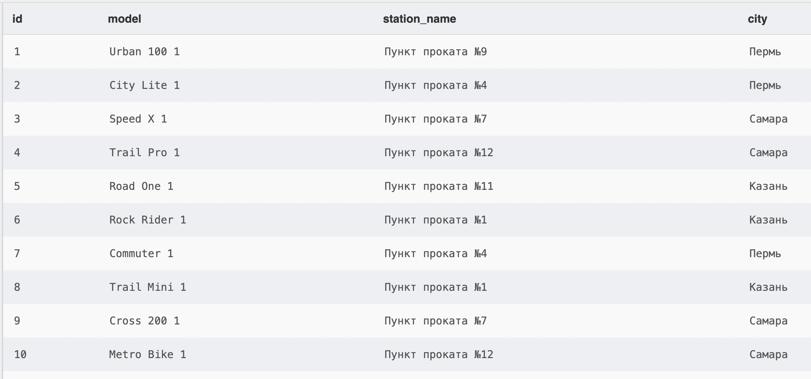

**Шаг 5 — все станции и велосипеды.** Используем `LEFT JOIN`, чтобы сохранить в результате все пункты проката, включая пункты без велосипедов.

```sql
SELECT s.id, s.station_name, b.model FROM stations s LEFT JOIN bicycles b ON b.station_id=s.id ORDER BY s.id,b.id;
```

**Результат:**

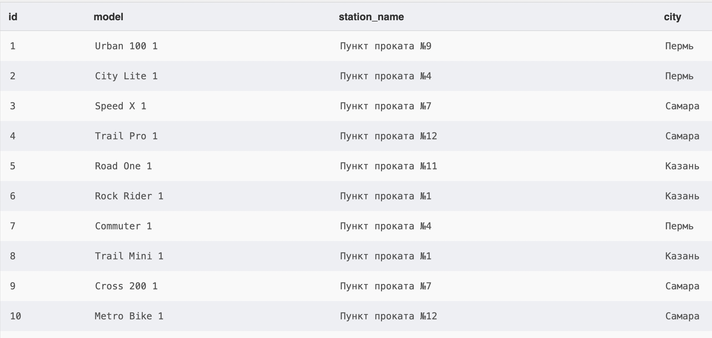

**Вывод:** `INNER JOIN` выводит совпавшие записи, а `LEFT JOIN` сохраняет строки из левой таблицы даже при отсутствии соответствий.

## Шаг 6. Проверка корректности данных

**Шаг 6 — проверка длительности аренды.** Проверяем, нет ли аренд с нулевой, отрицательной или отсутствующей длительностью.

```sql
SELECT COUNT(*) AS invalid_rental_days FROM rentals WHERE rental_days <= 0 OR rental_days IS NULL;
```

**Результат:**

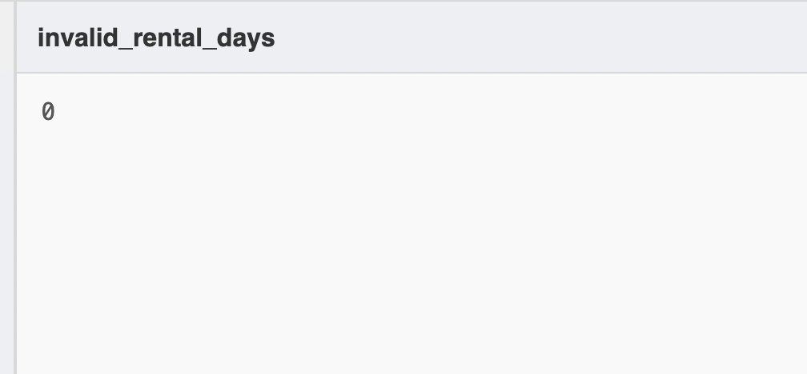

**Шаг 6 — проверка связей платежей.** Проверяем, нет ли платежей, ссылающихся на несуществующую аренду.

```sql
SELECT COUNT(*) AS orphan_payments FROM payments p LEFT JOIN rentals r ON p.rental_id=r.id WHERE r.id IS NULL;
```

**Результат:**

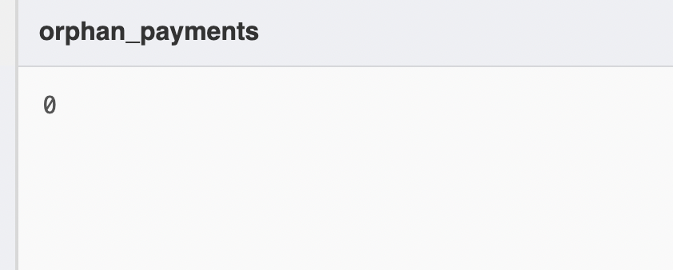

**Вывод:** оба запроса вернули 0. В рамках проведённых проверок нарушений не обнаружено. Это не означает, что проверены абсолютно все возможные ошибки в данных.

## Шаг 7. Индивидуальное аналитическое исследование (пример)

**Исследовательский вопрос:** какие категории велосипедов и пункты проката связаны с наибольшей фактической выручкой по зарегистрированным платежам?

**Метод:** учитываем только аренды, у которых имеется запись в `payments`; выручка рассчитывается как `SUM(payments.amount)`. Незавершённые и отменённые аренды без платежа не включаются. Расходы на обслуживание не вычитаются.

**Шаг 7 — аналитика по категориям.** Группируем оплаченные аренды по категориям велосипедов.

```sql
SELECT b.category, COUNT(*) AS completed_rentals, SUM(p.amount) AS revenue_rub, ROUND(AVG(p.amount),2) AS avg_payment_rub FROM payments p INNER JOIN rentals r ON p.rental_id=r.id INNER JOIN bicycles b ON r.bicycle_id=b.id GROUP BY b.category ORDER BY revenue_rub DESC;
```

**Результат:**

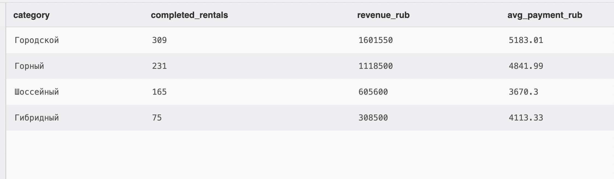

**Шаг 7 — аналитика по станциям.** Сравниваем пункты проката по сумме платежей.

```sql
SELECT s.station_name, COUNT(*) AS paid_rentals, SUM(p.amount) AS revenue_rub FROM payments p INNER JOIN rentals r ON p.rental_id=r.id INNER JOIN bicycles b ON r.bicycle_id=b.id INNER JOIN stations s ON b.station_id=s.id GROUP BY s.id,s.station_name ORDER BY revenue_rub DESC LIMIT 10;
```

**Результат:**

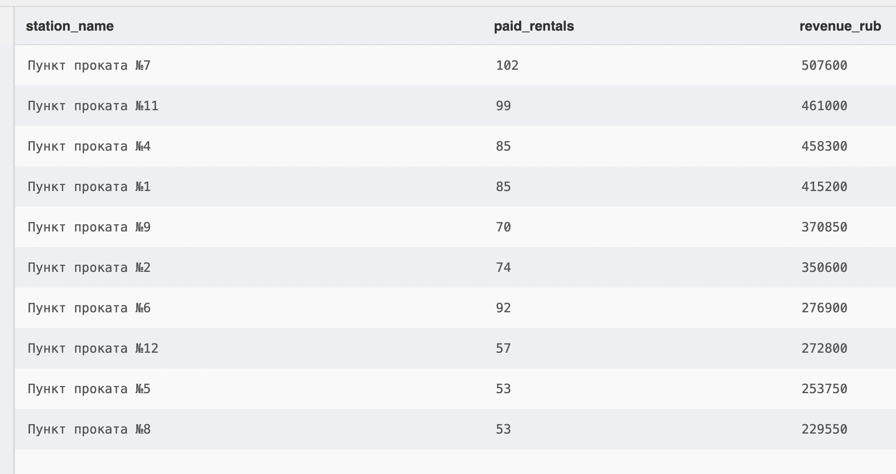

**Дополнительная проверка — велосипеды без аренд:**

**Шаг 7 — неиспользуемые велосипеды.** Используем `LEFT JOIN` для поиска велосипедов без единой записи в `rentals`.

```sql
SELECT b.id, b.model, b.category FROM bicycles b LEFT JOIN rentals r ON b.id=r.bicycle_id WHERE r.id IS NULL ORDER BY b.id;
```

**Результат:**

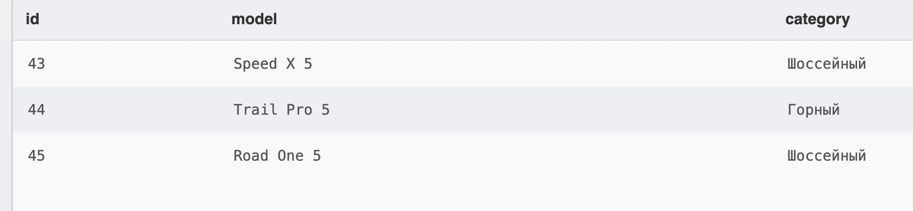

**Аналитические выводы:**

1. Наибольшую сумму платежей принесла категория **Городской** — **1,601,550 руб.** (309 оплаченных аренд).
2. Общая зарегистрированная выручка по 780 платежам составляет **3,634,150 руб.**; это сумма платежей, а не прибыль сервиса.
3. Сравнение пунктов проката показывает различия в выручке. Рейтинг зависит как от числа аренд, так и от тарифа и длительности аренды.
4. Велосипедов без единой аренды — **3**. Их наличие можно использовать как повод для отдельного анализа спроса.

## Итог

В работе изучена структура SQLite-базы из шести связанных таблиц, выполнены запросы с `WHERE`, `ORDER BY`, `LIMIT`, агрегатными функциями, `GROUP BY`, `HAVING`, `INNER JOIN`, `LEFT JOIN`; проведены проверки целостности и отдельное аналитическое исследование.

**Ограничения:** платежи отражают зарегистрированную выручку, но не учитывают все возможные расходы и возвраты. Выводы относятся только к данному учебному набору данных.

## Структура файлов на GitHub

```text
lab04/
├── README.md
├── lab04_example_bike_rentals_expanded.sqlite
├── report/
│   └── analysis.md
└── images/
    ├── step01_counts.png
    ├── step02_preview.png
    ├── step02_schema.png
    ├── step03_filter.png
    ├── step03_sort.png
    ├── step04_count.png
    ├── step04_aggregates.png
    ├── step04_having.png
    ├── step05_join_customers.png
    ├── step05_join_stations.png
    ├── step05_left_join.png
    ├── step06_invalid.png
    ├── step06_orphans.png
    ├── step07_categories.png
    ├── step07_station_revenue.png
    └── step07_unused.png
```
