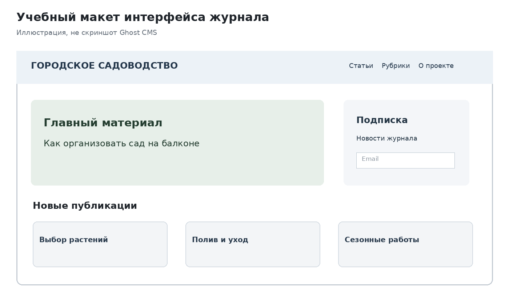
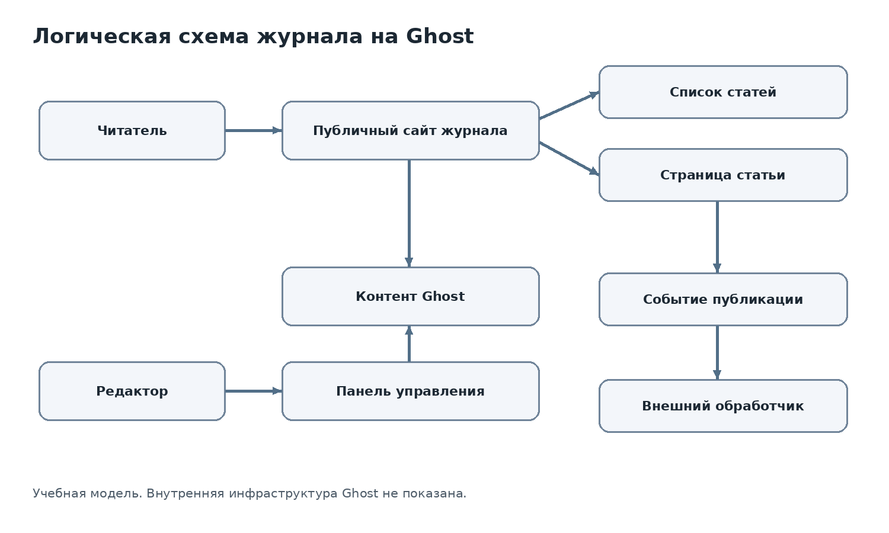

# Лабораторная работа №6. Анализ платформенного решения (CMS/low-code)

**Тема:** Анализ платформенного решения (CMS/low-code)  
**Платформа:** Ghost CMS  
**Учебный цифровой продукт:** «Журнал городского садоводства»  
**Тип примера:** демонстрационный, вне вариантов 1–10

> **Примечание.** Это учебный образец аналитического отчёта. Описываемые возможности Ghost следует сверять с документацией актуальной версии и условиями выбранного способа размещения. В примере нет утверждений о результатах реального тестирования интерфейса, тарифов или API. Проектируемые элементы помечены как проектные решения.

## 1. Выбранная платформа и источники

### 1.1. Назначение и класс решения

**Ghost** — система управления контентом (CMS), ориентированная на публикацию материалов, работу редакции и подписную аудиторию. В учебном проекте платформа рассматривается как основа для тематического интернет-журнала.

**Способ предоставления:** управляемое размещение Ghost(Pro) либо самостоятельное развёртывание Ghost на собственной инфраструктуре. Конкретные возможности и ответственность за обслуживание зависят от выбранного варианта.

**Проект «Журнал городского садоводства»:** открытый сайт с публикациями о выращивании растений в городе, рубриками, страницами авторов и формой подписки на новые материалы. Целевые пользователи — читатели, авторы и редакторы.

**Ключевые функции проекта:**

1. Просмотр списка публикаций и отдельных статей.
2. Навигация по тематическим рубрикам.
3. Поиск или фильтрация материалов — при наличии подходящего механизма в выбранной теме либо через дополнительное решение.
4. Публикация и редактирование материалов уполномоченными сотрудниками.
5. Подписка на обновления с учётом возможностей выбранной конфигурации.

**Условия исследования:** анализ открытой документации и типовых возможностей Ghost; личное тестирование административной панели и платных возможностей в рамках этого примера не проводилось. Поэтому конкретные ограничения тарифов и интерфейсных элементов не заявляются как проверенные наблюдения.

### 1.2. Источники

| № | Источник | Для чего используется |
|---|---|---|
| 1 | [Ghost — официальный сайт](https://ghost.org/) | Назначение и основные сценарии применения |
| 2 | [Ghost Docs](https://ghost.org/docs/) | Документация по установке, работе и настройке |
| 3 | [Ghost Themes](https://ghost.org/docs/themes/) | Темы оформления, шаблоны и разработка представления |
| 4 | [Ghost Content API](https://ghost.org/docs/content-api/) | Получение опубликованного контента |
| 5 | [Ghost Admin API](https://ghost.org/docs/admin-api/) | Программное управление контентом и административные операции |

**Дата обращения:** при использовании примера студент указывает собственную фактическую дату проверки ссылок. Ссылки приведены как источники для проверки, а не как подтверждение тестирования всех функций.

## 2. Страницы, шаблоны и компоненты

### 2.1. Структура интерфейса проекта

Для журнала предлагается следующая структура:

- **Главная страница:** последние статьи, выделенный материал, навигация по темам.
- **Страница рубрики:** список публикаций по одной теме.
- **Страница статьи:** заголовок, автор, дата, содержание, изображения, ссылки на связанные материалы.
- **Страница автора:** сведения об авторе и список его публикаций.
- **Страница «О проекте»:** редакционная информация и контакты.

Это **проектная структура** журнала, а не утверждение о готовом наборе страниц в любой установке Ghost.

### 2.2. Шаблоны и элементы

В Ghost внешний вид сайта определяется темой оформления. Тема задаёт шаблоны и представление опубликованного контента. Для реализации нестандартного поведения может понадобиться изменение темы либо дополнительная интеграция.

| Элемент | Назначение в журнале | Способ настройки | Статус вывода |
|---|---|---|---|
| Шаблон статьи | Единообразное отображение публикаций | Выбор или изменение темы, настройка шаблона | Документируемый механизм тем; конкретная реализация проектная |
| Карточка статьи | Краткое представление материала в списке | Разметка и стили темы | Проектное решение |
| Навигационное меню | Переход между разделами | Настройки сайта и/или тема | Требует проверки для выбранной конфигурации |
| Изображение публикации | Визуальное оформление статьи | Поля публикации и шаблон | Документируемая модель контента |
| Форма подписки | Подписка читателя на обновления | Штатные возможности и настройки выбранной конфигурации | Требует проверки доступности |

**Учебный макет интерфейса (не скриншот Ghost):**

### 2.3. Пример последовательности настройки

**Задача:** добавить в журнал новую статью.

1. Редактор входит в административную часть с учётной записью, имеющей право публикации.
2. Создаёт новую публикацию, вводит заголовок и основной текст.
3. Добавляет изображение, автора и тематические метки, если они предусмотрены редакционной моделью.
4. Проверяет предварительное представление материала.
5. Сохраняет черновик или публикует материал в соответствии с редакционным процессом.
6. Проверяет отображение статьи на публичном сайте.

Последовательность отражает **типовой рабочий сценарий**, а не протокол реально выполненных действий в данном примере.

## 3. Контент и способы настройки

### 3.1. Модель контента

Для журнала выделены две основные сущности: «Публикация» и «Автор». Тематические метки используются для группировки материалов.

| Сущность | Поле | Тип / смысл | Связь |
|---|---|---|---|
| Публикация | Заголовок | Текст | — |
| Публикация | Основной текст | Содержимое статьи | — |
| Публикация | Дата публикации | Дата и время | — |
| Публикация | Автор | Ссылка на автора | Публикация → Автор |
| Публикация | Метки | Тематические категории | Публикация → Метки |
| Автор | Имя | Текст | — |
| Автор | Биография | Текст | — |
| Автор | Изображение | Медиафайл | — |

**Важно:** таблица — упрощённая логическая модель для учебного продукта. Она не является точным описанием таблиц базы данных Ghost.

### 3.2. Способы настройки

| Категория | Пример для проекта | Ограничение |
|---|---|---|
| Без программирования | Создание статей, редактирование текста и изображений | Не обеспечивает произвольную бизнес-логику |
| Через готовые настройки и тему | Изменение внешнего вида в пределах возможностей темы | Набор настроек зависит от темы |
| Через код и внешние сервисы | Изменение шаблонов, собственный поиск, дополнительные интеграции | Требуются разработка, тестирование и сопровождение |

**Пример изменения требований:** добавление новой рубрики статей обычно укладывается в модель публикаций и меток. Требование автоматически подбирать индивидуальный план посадок по данным пользователя потребует отдельной проверки: такой сценарий предполагает прикладную логику, выходящую за рамки обычной публикации контента.

## 4. Интеграции и обмен данными

### 4.1. Доступные механизмы

| Механизм | Назначение | Направление данных | Источник / ограничение |
|---|---|---|---|
| Content API | Получение опубликованных материалов внешним приложением | Ghost → внешний клиент | [Документация](https://ghost.org/docs/content-api/); требуется настройка доступа |
| Admin API | Автоматизация операций с контентом | Внешний сервис ↔ Ghost | [Документация](https://ghost.org/docs/admin-api/); нужны соответствующие полномочия и безопасное хранение ключей |
| Webhooks | Уведомление внешнего сервиса о событиях | Ghost → внешний обработчик | Проверить поддерживаемые события и настройку в документации конкретной версии |

### 4.2. Сценарий интеграции

**Проектная задача:** при публикации новой статьи уведомлять редакционный канал в стороннем сервисе.

1. Редактор публикует материал в Ghost.
2. Настроенный механизм события формирует уведомление о публикации.
3. Внешний обработчик принимает уведомление.
4. Обработчик проверяет событие и извлекает идентификатор или адрес материала.
5. При необходимости получает дополнительные открытые сведения через Content API.
6. Отправляет сообщение в редакционный канал.

**Риски:** сбой внешнего обработчика; повторная доставка события; разглашение секретов доступа; различия в поддерживаемых событиях и настройках. Для надёжной реализации потребуется обработка ошибок и повторов.

**Статус:** это предложенная схема интеграции; её работоспособность в конкретной конфигурации необходимо проверить отдельно.

## 5. Логическая схема цифрового продукта

**Исходный файл схемы:** [product_scheme.svg](../images/product_scheme.svg)

**Граница ответственности:** публичные страницы и редакторские функции относятся к продукту на Ghost; внешний обработчик и канал уведомлений — отдельные компоненты проектируемой интеграции. Схема логическая, без предположений о внутренних серверах и структуре исходного кода Ghost.

**Путь пользовательского действия — чтение статьи:**

1. Читатель открывает главную страницу журнала.
2. Интерфейс отображает список опубликованных материалов.
3. Читатель выбирает статью.
4. Страница статьи получает и отображает необходимые данные публикации.
5. Читатель переходит к материалам с той же тематической меткой.

## 6. Ограничения кастомизации и зависимость от платформы

| Ограничение / риск | Когда проявляется | Подтверждение или статус | Снижение риска |
|---|---|---|---|
| Нестандартная бизнес-логика | Нужны сложные вычисления и персональные сценарии | Проектный риск: CMS ориентирована на контент; конкретный механизм нужно проверить | Вынести сложную логику в отдельный сервис |
| Изменение интерфейса | Требуется дизайн, не поддерживаемый выбранной темой | Возможности темы зависят от реализации | Оценить исходный код темы и стоимость доработки |
| Интеграции и API | Требуется синхронизация с внешними системами | Наличие API документируется; права и ограничения проверяются отдельно | Прототип интеграции, контроль ошибок, журналирование |
| Производительность | Растёт число читателей и запросов | Зависит от размещения, кеширования и конфигурации; количественная оценка не проводилась | Нагрузочное тестирование и мониторинг |
| Vendor lock-in | Необходим переход на другую CMS | Перенос шаблонов, настроек и редакционных процессов может потребовать работы | Регулярный экспорт данных, документация структуры, инвентаризация интеграций |
| Безопасность | Увеличивается число редакторов и внешних подключений | Конкретный уровень защищённости не проверялся | Минимальные права, обновления, резервные копии, защита ключей |

### 6.1. Оценка переносимости

Публикации и медиафайлы потенциально можно переносить между системами при наличии подходящих механизмов экспорта и импорта. При этом **данные, оформление и функциональность — разные объекты переноса**: шаблоны Ghost, настройки темы, интеграционные сценарии и редакционные процессы могут потребовать отдельной реализации в новой CMS.

**Предлагаемые меры:**

1. Поддерживать актуальный список типов контента, меток и связей.
2. Регулярно проверять возможность выгрузки материалов и медиафайлов.
3. Документировать изменения темы и внешние интеграции.
4. Хранить секреты доступа отдельно от исходного кода и отчётов.

## 7. Применимость платформы и рекомендации

### 7.1. Матрица применимости

| Тип проекта | Ключевые требования | Оценка | Обоснование |
|---|---|---|---|
| Лендинг | Несколько информационных блоков, форма обратной связи | Подходит при условиях | Возможно использование CMS, но для одностраничного проекта настройка может оказаться избыточной; форму и оформление нужно проверить |
| Корпоративный сайт | Публикации, разделы, редакторы | Подходит при условиях | Сильная сторона — контент; специфические корпоративные процессы могут потребовать расширений |
| Каталог с обновлением данных | Структурированные карточки, сложные фильтры, импорт | Требует дополнительной оценки | Необходимо проверить модель данных, фильтрацию и интеграции; возможно потребуется отдельный сервис |
| Внутренний сервис с ролями | Заявки, статусы, согласования, разграничение прав | Не рекомендуется как основа без существенных доработок | Для сложных рабочих процессов целесообразно рассмотреть специализированную low-code-платформу или кастомное приложение |

### 7.2. Рекомендация для «Журнала городского садоводства»

**Рекомендуемый подход:** использовать Ghost как основу публикационного сайта, а нестандартные функции при необходимости выносить во внешние сервисы.

**Аргументы:**

1. Основной сценарий проекта — создание, редактирование и чтение публикаций.
2. Нужна единая система управления редакционным контентом и авторами.
3. Темы и механизмы получения контента позволяют развивать публичное представление без создания собственной CMS с нуля.

**Основные компромиссы:**

- Быстрый запуск редакционного сайта достигается ценой зависимости от модели контента и механизмов настройки Ghost.
- Использование внешних сервисов расширяет функциональность, но увеличивает сложность интеграций и сопровождения.

**Условие пересмотра решения:** если журнал превратится в сервис персональных рекомендаций с пользовательскими профилями, сложными правилами расчёта и большим количеством взаимосвязанных сущностей, необходимо повторно оценить архитектуру: оставить Ghost для публикаций и добавить отдельное приложение либо перейти к иной платформе.

### 7.3. Выводы

**Вывод 1.** Ghost выглядит обоснованным кандидатом для проекта, где основную ценность составляет редакционный контент, поскольку позволяет опираться на готовые механизмы публикации.

**Вывод 2.** Наличие CMS и API не означает, что сложные бизнес-процессы можно реализовать без разработки. Возможности интеграции необходимо проверять по конкретному сценарию.

**Вывод 3.** Выбор платформы зависит от характера требований. Для журнала важны публикации и редакционная работа, а для внутренней системы согласования — статусы, права и бизнес-логика.

**Вывод 4.** Риск зависимости от поставщика связан не только с выгрузкой текстов, но и с переносом тем, интеграций, настроек и процессов работы.

### 7.4. Ограничения исследования

- Не выполнялось практическое развёртывание Ghost и проверка административной панели.
- Не проводились измерения производительности и проверка защищённости.
- Доступность отдельных функций, лимитов и тарифов требует актуальной проверки.
- Логическая схема представляет **проектное решение**, а не подтверждённую внутреннюю архитектуру Ghost.

## Источники

1. Ghost. Официальный сайт: https://ghost.org/
2. Ghost. Documentation: https://ghost.org/docs/
3. Ghost. Themes: https://ghost.org/docs/themes/
4. Ghost. Content API: https://ghost.org/docs/content-api/
5. Ghost. Admin API: https://ghost.org/docs/admin-api/

**Дата обращения к источникам:** заполнить после фактической проверки перед сдачей.
